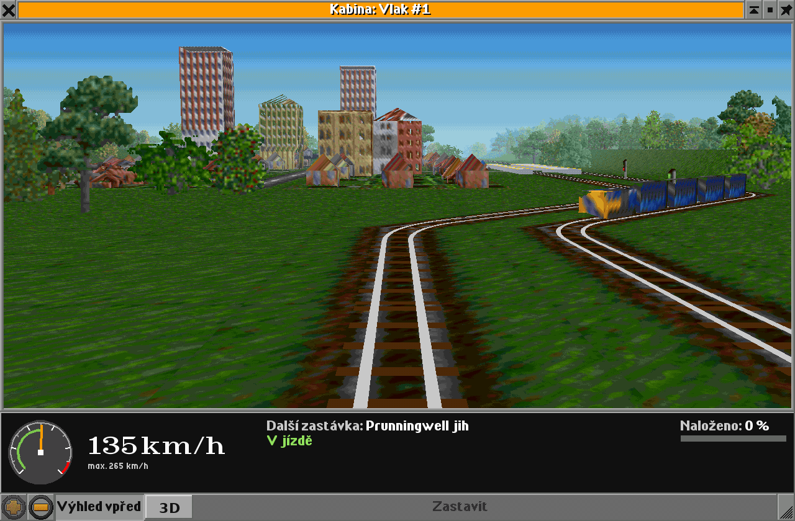
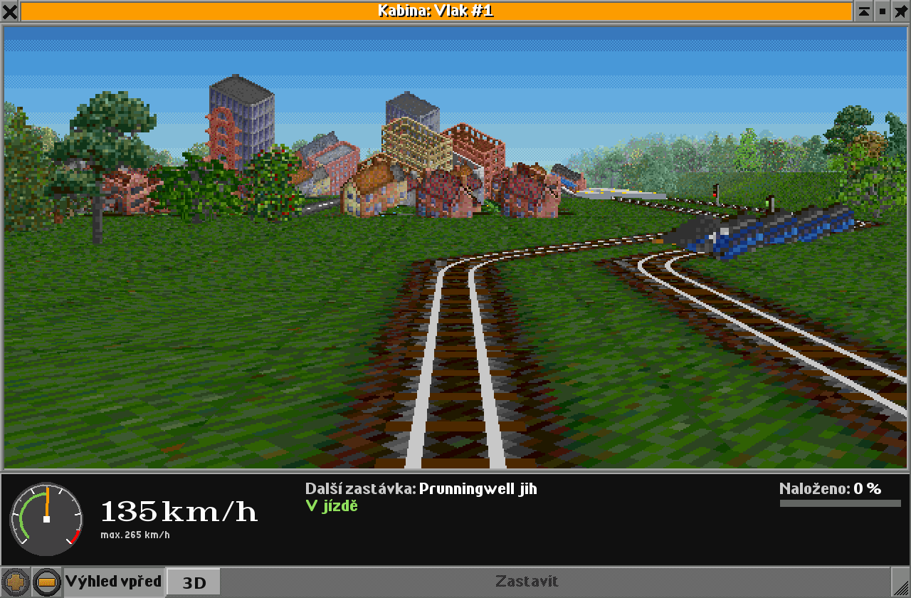
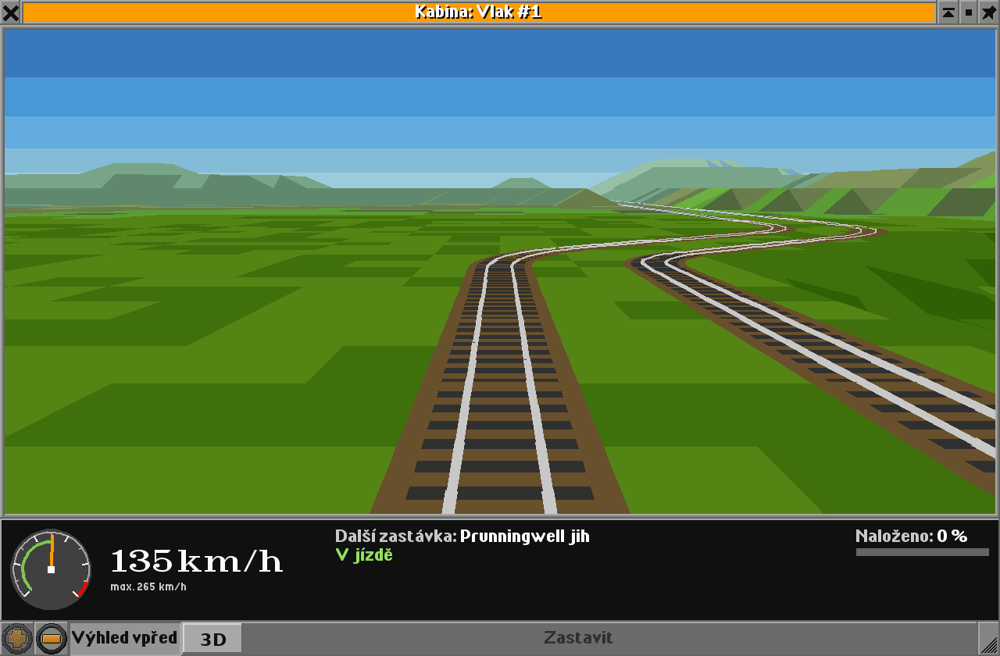
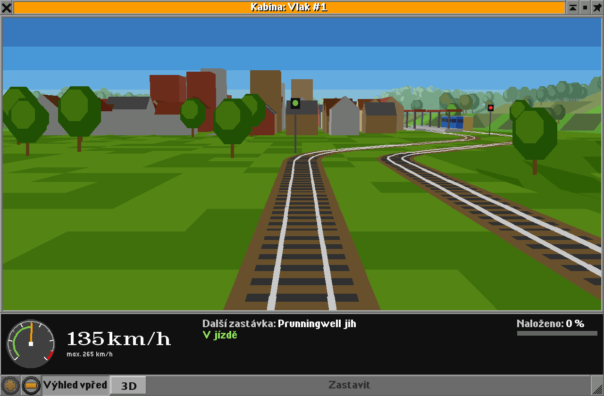

# Jednoduchý 3D pohled z kabiny – návrh (etapa 2)

Tohle je návrh k připomínkám, ne hotový kód. Obrázky jsou vyrenderované prototypy v `3d_mockup/`,
které kreslí **stejným způsobem, jaký by použila hra** (po dlaždicích od nejvzdálenější k nejbližší,
barvy jen z 256barevné palety OpenTTD). Nejsou to tedy malby „jak by to mohlo být“, ale zhruba to,
co hra opravdu dokáže nakreslit.

Jsou dvě varianty vzhledu. Václav u první (plné barvy, kvádry) řekl, že funkčně je dobrá, ale chybí jí
kouzlo TTD. Proto vznikla **varianta B s grafikou ze hry**. U ní mu vadily velké pixely a domy jako kulisy
„stupňovitě nad sebou“. Z toho vznikla **varianta C**: opravdové 3D tvary oblečené do grafiky
ze hry, kreslené jemně. **Václav ji 12. 10. 2026 schválil („Jo, tohle je lepší.“).**

## Varianta C – 3D tvary s grafikou ze hry (schválená)



- **Plné rozlišení obrazovky** (na Retině 2×) a plynulé (bilineární) vzorkování textur, takže
  žádné velké pixely. Zblízka přidává jemný vzor (1/4 jednotky) na zemi, aby nebyla rozmazaná.
  Barvy se nakonec stejně přichytí k paletě, přechody s jemným ditheringem.
- **Domy a nádražní budovy jsou kvádry ve 3D.** Fasády a střechy se vyříznou přímo ze spritu domu:
  bod budovy (x, y, z) leží ve spritu na pixelu (c₀ + 2(y − x), r₀ + (x + y) − z), což je přesně
  projekce hry (`RemapCoords`). Každá zeď tak dostane fasádu, kterou hra kreslí. Domy se šikmou
  střechou dostanou valbovou střechu, na kterou padnou namalované tašky ze spritu.
- **Vlaky jsou také kvádry** podél koleje, s boky, čelem a střechou ze spritu vozidla.
- **Stromy** zůstávají jako vystřižené obrázky (jako v každé 3D hře), ale plynule zmenšené.
- Kód ve hře je stejný jako u B (vlastní buffer, načtení spritů přes `SpriteLoaderGrf`), jen se
  kreslí v plném rozlišení (~790 000 pixelů na Retině) a zdi domů přibydou jako další trojúhelníky.
  Rychlost změřím v kroku 3; když by to bylo pomalé, pojede 3D pohled v polovičním rozlišení s vyhlazeným zvětšením.

## Varianta B – grafika ze hry, kulisy a velké pixely



- **Zem** každé dlaždice je její vlastní sprite ze hry (tráva, štěrk s kolejí, silnice, pole, voda,
  zahrádka u domu). Kosočtverec z izometrického pohledu se „rozbalí“ zpátky na čtverec dlaždice
  a nakreslí v perspektivě. Na svazích se jen ztmaví podle sklonu.
- **Kolejnice a pražce** se kreslí navíc přes štěrk jako ostré čáry, aby byly zblízka čisté
  a v obloucích 45° měly malý poloměr (štěrk zůstává lomený přesně jako ve hře).
- **Domy, stromy, nádražní budovy a návěstidla** jsou jejich izometrické sprity postavené na dlaždici
  jako kulisy z kartonu a zmenšené podle vzdálenosti. Je to nepřesné (díváme se na ně „shora“
  i zepředu zároveň), ale přesně to dělá to kouzlo – vypadá to jako svět TTD, ne jako jiná hra.
- **Vlaky** mají ve hře 8 spritů podle směru. Vybere se ten, který odpovídá úhlu, pod kterým vlak
  vidíme (jako postavy ve starých 3D hrách). Na obrázku přijíždí vlak po vedlejší koleji.
- **Celé se to kreslí ve velikosti rozhraní 1×** a pak zvětší bez vyhlazování, takže má i na Retině
  ty typické velké pixely jako zbytek hry.
- Opar v dálce a obloha jako ve variantě A, přechody na obloze jsou dithrované šachovnicí (jako
  `FILLRECT_CHECKER`), aby nebyly vidět ostré pruhy.

### Jak to udělat v kódu (navíc oproti variantě A)

- Hra má sprity v paměti už zakódované pro aktuální blitter, takže z nich nejde přímo číst pixely.
  Potřebné sprity si 3D pohled jednou načte znovu v 8bit podobě přes `SpriteLoaderGrf` (stejně jako hra
  při načítání). Díky tomu se použije i grafika z NewGRF, kterou má hráč nainstalovanou.
- Kreslí se do vlastního 8bit bufferu (index palety na pixel) ve velikosti 1× a ten se pak přenese
  na obrazovku zvětšený podle velikosti rozhraní přes `Blitter::SetPixel` / `Blitter::DrawRect`
  (běhy stejné barvy). Funguje to s 8bpp i 32bpp blitterem i s OpenGL ovladačem.
- Zem: pro každou dlaždici dva trojúhelníky s texturou (perspektivně správné mapování),
  ~200 000 pixelů na snímek při okně 640×310 v 1×. To je pro dnešní procesor málo, ale změřím to
  v kroku 3 na Linuxu a na Macu.
- Rizika: zakódování spritů (načítání mimo sprite cache) je zásah do vnitřností hry; když by to
  nešlo čistě, náhradní řešení je vzít jen průměrnou barvu spritu (pak je to zhruba varianta A
  se sprity pro domy a stromy).

## Varianta A – plné barvy (první návrh)


Okno Kabina zůstane stejné (palubní deska, tlačítka). V liště tlačítek přibude přepínač **3D**:
vypnutý = dnešní pohled shora, zapnutý = pohled strojvedoucího dopředu po trati.

Krok 3 (první verze: terén a trať):



Krok 4 (doplněný svět: domy, nádraží, návěstidla, stromy, jiné vlaky):



Obrázky jsou ve velikosti rozhraní 2× (jako na Retině). Pohled se kreslí po pixelech obrazovky,
takže na Retině je ostrý, ne rozmazaný.

### Co je na obrázcích

| Věc | Jak se kreslí | Odkud se vezme |
|---|---|---|
| Terén | každá dlaždice jako čtyřúhelník (nebo 2 trojúhelníky na svahu), stínovaný podle sklonu ke slunci | výšky rohů dlaždic (`TileHeight`, `GetTileSlope`) |
| Tráva u vlaku | dlaždice rozdělená na 2×2 plošky lehce jiné zelené – bez toho není na rovině vidět rychlost | jen kosmetika |
| Voda, pláž, pole | barva podle typu dlaždice, pole s brázdami | `GetTileType`, typ terénu (`MP_WATER`, `MP_CLEAR` + pole) |
| Koleje | hnědé štěrkové lože, pražce (jen v blízkosti), dvě kolejnice jako čáry | `GetTrackBits` – trať jde středem dlaždice, výhybky a oblouky podle bitů |
| Silnice | šedý pás | `MP_ROAD`, `GetRoadBits` |
| Domy | kvádr, malé domy se sedlovou střechou, výška a barva podle typu domu | `MP_HOUSE`, `GetHouseType` (výška z velikosti budovy, barva z tabulky) |
| Nádraží | nástupiště jako nízký kvádr, přístřešky | `MP_STATION`, typ stanice |
| Návěstidla | sloup + hlava se světlem (zelená / červená) | `HasSignals`, stav návěstidla |
| Stromy | jednoduché „lízátko“ natočené vždy k nám (2 osmiúhelníky + kmen) | `MP_TREES`, počet stromů na dlaždici |
| Jiná vozidla | kvádr na každý vagon, barva společnosti, okna pruhem, čelo jinou barvou | vozidla na dlaždici (`VehiclesOnTile`), jejich `x_pos`, `y_pos`, `z_pos`, směr |
| Obloha | 5 pruhů modré z palety | – |
| Opar v dálce | barvy postupně přechází do barvy oblohy, konec mapy tak není vidět | vzdálenost |

Průmysl a objekty (vysílače, majáky…) budou v kroku 4 také kvádry s barvou podle typu.

## Jak to bude fungovat v kódu (obě varianty)

- **Kamera** sedí na čele vlaku (`x_pos`, `y_pos`, `z_pos` prvního vozidla) ve výšce střechy (8 jednotek),
  dívá se ve směru jízdy, 6° dolů, zorný úhel 64°. Směr kamery se plynule dotáčí stejně jako dnešní
  výhled vpřed (časová konstanta 650 ms) a v obloucích se může natáčet podle `GetTrackLookAheadTarget`,
  který už v etapě 1 existuje.
- **Měřítko** je převzaté ze hry: dlaždice 16 jednotek, výškový stupeň 8, vagon 8 jednotek dlouhý.
  Výšky domů a vlaků jsou ale „herní“, ne skutečné (dům ~10, věžák 20–35, vlak 6), jinak by ve 3D
  všechno vedle velkých dlaždic vypadalo jako mravenci.
- **Kreslení**: projdou se dlaždice v zorném poli do vzdálenosti 56 dlaždic, seřadí se od nejvzdálenější
  a každá se nakreslí celá (zem → koleje/silnice → objekty). Bližší věci tak přirozeně překryjí vzdálenější
  (malířův algoritmus), žádný z-buffer není potřeba.
- **Nástroje hry**: jen `GfxFillPolygon`, `GfxFillRect` a `GfxDrawLine`. Ty fungují se všemi blittery
  (8bpp i 32bpp) i s OpenGL ovladačem, protože kreslí do stejné obrazovky jako zbytek rozhraní.
  Žádné OpenGL ani nové knihovny – funguje to všude, kde běží OpenTTD, včetně Macu.
- **Barvy**: každá barva se při startu přepočítá na nejbližší barvu palety a pro opar se předpočítá
  8 stupňů k barvě oblohy. Za běhu je to jen vyhledání v tabulce.
- **Okno**: místo viewportu bude v okně `NWID_SELECTION`, který přepíná mezi dnešním viewportem a novým
  panelem, kam se 3D kreslí v `DrawWidget`. Překreslování při každém pohybu vlaku, nejvýš ~30× za sekundu.
- **Kolik je to práce pro počítač**: prototyp kreslí na scénu z obrázku ~4 200 (krok 3) a ~4 600 (krok 4)
  mnohoúhelníků. To je pro software málo; na Retině je ale okno 4× víc pixelů, takže v kroku 3
  změřím čas jednoho snímku na Linuxu a na Macu. Rezervy, pokud by to bylo pomalé: kratší dohled,
  vzdálené dlaždice slučovat po 2×2, kreslit 3D jen při změně polohy.

## Co nebude (záměrně)

- Žádné textury ani původní grafika (sprity) – NewGRF vzhled vlaků a domů se nepřenese, jen barvy.
- Tunely: uvnitř tunelu jen tma s obrysem portálu na konci; mosty jako deska na pilířích (krok 4).
- Stíny, odrazy, noc – ne.
- Pohled zezadu nebo z boku vlaku – možná později, kamera je na to připravená.

## Rozdělení na další kroky

**Krok 3 – první verze**: přepínač 2D/3D v okně Kabina, kamera, terén s výškami, voda, koleje
(rovné, oblouky, výhybky), opar a obloha. Jen vlaky. Test na Linuxu (1× a 2×), pak Václav na Macu.

**Krok 4 – doplnit svět**: silnice, domy, nádraží, návěstidla se stavem, stromy, ostatní vozidla, průmysl,
mosty a tunely; doladit plynulost na Retině.

## Otázky k rozhodnutí

1. **Vzhled**: rozhodnuto, varianta C.
2. **Výška pohledu**: navrhuji střechu vlaku (jako na obrázcích). Nižší (oči strojvedoucího) je realističtější,
   ale vidí se mnohem méně z trati před vlakem.
3. **Kde přepínač**: tlačítko „3D“ vedle „Výhled vpřed“ (jako na obrázcích).

## Prototyp

```
python3 cab_view_dev/3d_mockup/mockup.py src/table/palettes.h <snímek okna Kabina ve 2×> <výstupní složka>
python3 cab_view_dev/3d_mockup/mockup_ttd.py <zdroják OpenGFX> <snímek okna Kabina ve 2×> <výstupní složka>
python3 cab_view_dev/3d_mockup/mockup_ttd3d.py <zdroják OpenGFX> <snímek okna Kabina ve 2×> <výstupní složka>
```

Potřebuje Python 3 s `numpy` a `Pillow`. Varianty B a C čtou grafiku přímo ze zdrojáků OpenGFX
(`git clone https://github.com/OpenTTD/OpenGFX`, tag 8.0; `ogfx.py` umí číst jejich `.pnml` a `.png`). Svět je smyšlený (dvoukolejka s obloukem, městečko,
nádraží, kopce), z mapy hry se nic nečte.
